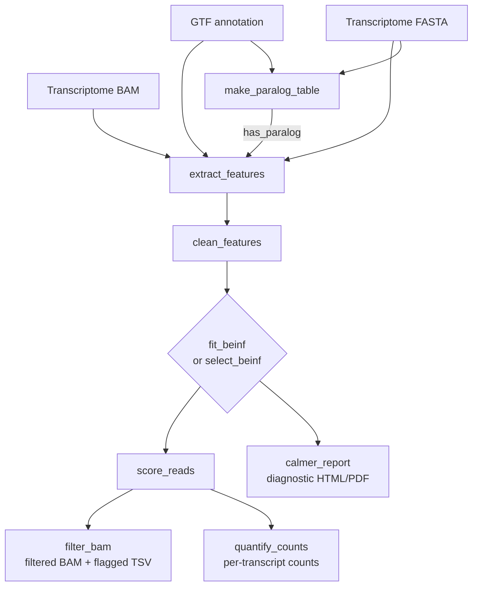

# CALMeR

[](https://www.r-project.org/)
[](LICENSE)
[](https://doi.org/10.64898/2026.10.26.761703)

**C**ontext-**A**ware **L**ong-read **MAPQ** **R**escuer.

CALMeR rescues long-read transcriptome alignments that a fixed MAPQ cutoff would
wrongly discard. A uniform MAPQ threshold disproportionately removes reads from
multi-isoform genes, paralogous transcripts, and other high-ambiguity contexts —
exactly where low MAPQ is *expected* and not a sign of a bad alignment. CALMeR
instead learns what MAPQ to expect for each read given its transcript context,
and flags only the reads whose MAPQ falls well below that expectation.

Concretely, it fits a Beta-Inflated (BEINF) regression model of `MAPQ / 60` on
transcript-level structural features (number of isoforms, transcript length, GC
content, percent covered, and cross-gene paralog presence) on a sampled subset of
reads, computes randomized quantile residuals (RQR) on the full BAM, and removes
reads with anomalously low residuals.

## How it works

1. **Extract features** (`extract_features`): per-read alignment features (`MAPQ`,
   alignment length, primary/secondary) joined to per-transcript context
   (`tx_length`, `n_isoforms`, `gc_content`, `n_exons`, and `has_paralog` from a
   self-alignment).
2. **Clean** (`clean_features`): the canonical preprocessing — log-transform
   transcript length, lump very high isoform counts, winsorize percent covered,
   and z-score the continuous predictors.
3. **Model MAPQ** (`fit_beinf`, or `select_beinf` for backward model selection):
   fit a Beta-Inflated regression of `MAPQ / 60` on the context features.
4. **Score every read** (`score_reads`): compute each read's randomized quantile
   residual — how far its MAPQ sits from what the model expects given its
   context — and flag reads whose residual is anomalously low (MAPQ much lower
   than expected).
5. **Act on the result**: write a filtered BAM and a flagged-reads table
   (`filter_bam`), per-transcript counts from the retained reads
   (`quantify_counts`), and a diagnostic report (`calmer_report`).



## Installation

CALMeR has Bioconductor dependencies, so install it with `BiocManager`,
which resolves both the Bioconductor and CRAN dependencies:

```r
if (!requireNamespace("BiocManager", quietly = TRUE))
  install.packages("BiocManager")
BiocManager::install("sparthib/CALMeR")
```

`make_paralog_table()` additionally requires `minimap2` (>= 2.24) on the
`PATH` (only when no precomputed PAF or paralog table is supplied), and
rendering the HTML/PDF diagnostic report requires `pandoc` (bundled with
RStudio, or installed separately).

## Inputs

CALMeR works from a long-read **transcriptome** alignment — reads aligned to the
reference *transcripts*, not the genome. Three inputs are required, and they must
be mutually consistent (matching transcript identifiers):

| Input | What it is | Used for |
|-------|------------|----------|
| **BAM** | Long reads aligned to the transcriptome FASTA (e.g. `minimap2 -ax map-ont`), coordinate-sorted. An index (`.bai`) is created automatically if missing. | Per-read `MAPQ`, alignment length, primary/secondary flag |
| **Transcriptome FASTA** | The exact reference the reads were aligned to (one sequence per transcript). | GC content; and the self-alignment used to detect paralogs |
| **GTF** | Matching annotation. Exon records give transcript length (sum of exon widths) and exon count; `gene_id` groups transcripts into genes for the isoform count. | `tx_length`, `n_exons`, `n_isoforms` |

Transcript IDs across the BAM, FASTA, and GTF should match; a version-suffix
fallback is applied automatically (e.g. `ENST….5` ↔ `ENST…`).

**Optional — paralog status.** The paralog predictor comes from a `minimap2`
self-alignment of the transcriptome. You can let `make_paralog_table()` run
`minimap2` for you (requires `minimap2` on the `PATH`), point it at a precomputed
self-alignment PAF (`paf_path=`), or pass a ready-made table (TSV with
`transcript_id`, `has_paralog`). If skipped, reads default to `has_paralog = FALSE`.

> **Aligning reads:** retain secondary alignments so MAPQ reflects multi-mapping, e.g.
> `minimap2 -ax map-ont -N 100 transcriptome.fa reads.fq | samtools sort -o aln.bam`

## Quick start

CALMeR ships a small example bundle (~2,000 reads from a real PCR cDNA sample,
with a matching GTF, transcriptome FASTA, and a precomputed `minimap2`
self-alignment PAF) so you can run the whole pipeline end-to-end before touching
your own data:

```r
library(CALMeR)

ex <- calmer_example_data()   # paths to the bundled bam / gtf / fasta / paf

paralog  <- make_paralog_table(ex$fasta, ex$gtf, paf_path = ex$paf)
features <- extract_features(ex$bam, ex$gtf, ex$fasta, paralog_table = paralog)
clean    <- clean_features(features)

# The toy set is tiny, so fit a LINEAR model: the default penalized-spline
# `pb()` terms need far more reads to converge. On real data use the defaults
# (fit_beinf(clean, n = 50000, seed = 42)) or select_beinf() — see below.
fit <- fit_beinf(
  clean, n = 1000,
  formula       = y ~ tx_length_sc + gc_content_sc + pct_covered_sc +
                      n_isoforms + I(pmax(n_isoforms - 5, 0)) + has_paralog,
  sigma_formula = ~ 1, nu_formula = ~ 1, tau_formula = ~ 1
)

scored <- score_reads(clean, fit, filter_method = "mad", threshold = -2)
table(scored$flag_low)                 # how many reads were flagged

counts <- quantify_counts(scored)      # per-transcript counts from kept reads
filter_bam(ex$bam, scored,
           out_bam = tempfile(fileext = ".bam"),
           out_tsv = tempfile(fileext = ".tsv.gz"))
```

## Workflow

On real data (full read set), two entry points are available.

Single-model workflow (one BEINF fit, one diagnostic report):

```r
paralog  <- make_paralog_table(fasta, gtf, paf_path = "self.paf")
features <- extract_features(bam, gtf, fasta, paralog_table = paralog)
clean    <- clean_features(features)
fit      <- fit_beinf(clean, n = 50000, seed = 42, inter = 5)
scored   <- score_reads(clean, fit, filter_method = "mad",
                        threshold = -2, dev_threshold = 2)
filter_bam(bam, scored, out_bam = "filtered.bam", out_tsv = "flagged.tsv.gz")

# per-transcript counts from CALMeR-retained (unflagged) reads
counts   <- quantify_counts(scored)

calmer_report(fit, features = clean,
              out_file = "report.html", format = "html")
```

Model-selection workflow (backward GAMLSS selection, then report and
scoring against the picked model):

```r
paralog  <- make_paralog_table(fasta, gtf, paf_path = "self.paf")
features <- extract_features(bam, gtf, fasta, paralog_table = paralog)
clean    <- clean_features(features)

# Backward GAMLSS selection from the FULL BEINF model (pb smooths for the
# scaled predictors, the two-piece isoform basis, the paralog indicator,
# and the transcript-feature interactions). At each step the term whose
# removal most improves the GAIC is dropped, subject to marginality;
# k = log(n) => BIC by default (pass k = 2 for AIC). Both GAMLSS
# strategies are run and the picked (minimum-BIC) model is kept:
#   Strategy A (stepGAICAll.A): per-parameter sweeps (mu, sigma, nu, tau)
#   Strategy B (stepGAICAll.B): one interleaved search over all parameters
# Optionally add held-out scoring with evaluate = c("gaic", "holdout")
# (validation deviance via gamlss::gamlssVGD) or K-fold CV (cv_folds).
sel <- select_beinf(clean, strategies = c("A", "B"), evaluate = "gaic",
                    n = 50000, seed = 42, inter = 5, ncpus = 4)

# calmer_report() accepts the selection object directly: it re-scores
# against the picked model and renders the diagnostic report. The picked
# model name and the scored data are returned as attributes on the path.
out    <- calmer_report(sel, features = clean,
                        out_file = "report.html", format = "html")
picked <- attr(out, "picked_model")
scored <- attr(out, "scored")

filter_bam(bam, scored, out_bam = "filtered.bam", out_tsv = "flagged.tsv.gz")
counts <- quantify_counts(scored)
```

## Outputs

| Output | Produced by | What it is |
|--------|-------------|------------|
| **Filtered BAM** | `filter_bam()` | the input BAM with all alignments of flagged (anomalously low-MAPQ) reads removed |
| **Flagged-reads TSV** | `filter_bam()` | one row per flagged read, with the reason it was flagged |
| **Per-transcript counts** | `quantify_counts()` | counts from CALMeR-retained (unflagged) primary alignments, per transcript |
| **Diagnostic report** | `calmer_report()` | HTML/PDF: model summary, randomized-quantile-residual QQ/density plots, and flag statistics |

## Function reference

| Function | Purpose |
|----------|---------|
| `calmer_example_data()` | paths to the bundled example BAM / GTF / FASTA / PAF |
| `make_paralog_table()` | per-transcript `has_paralog` flag from a `minimap2` self-alignment |
| `extract_features()` | per-read + per-transcript features from BAM / GTF / FASTA |
| `clean_features()` | canonical preprocessing (log / lump / winsorize / z-score) |
| `fit_beinf()` | fit a single BEINF MAPQ model |
| `select_beinf()` | backward GAMLSS model selection; picks the model |
| `primary_fit()` | internal helper (used by `score_reads()`/`calmer_report()`): resolves the scorable fit from a fit or selection object |
| `score_reads()` | per-read randomized quantile residuals; flags low-residual reads |
| `filter_bam()` | write the filtered BAM and the flagged-reads TSV |
| `quantify_counts()` | per-transcript counts from retained reads |
| `calmer_report()` | render the diagnostic report (HTML/PDF) |
| `inspect_predictors()` | diagnostic plots of the predictor distributions |

## Predictors

The model conditions each read's MAPQ on the structural context of the
transcript it aligns to:

- **`tx_length`** — transcript length in nucleotides (sum of exon widths from the GTF).
- **`n_isoforms`** — number of annotated isoforms for the parent gene (ambiguity rises with more isoforms).
- **`gc_content`** — percent G+C of the transcript sequence.
- **`pct_covered`** — percent of the transcript spanned by the read alignment.
- **`has_paralog`** — whether the transcript has a cross-gene paralog (binary).

## Key parameters

- **`fit_beinf(n, seed)`** — `n` reads are subsampled (default 50,000) at `seed`
  to fit the model; the full BAM is still scored.
- **`score_reads(filter_method, threshold, dev_threshold)`** — `filter_method`
  (`"mad"` or `"z"`) sets how the residual cutoff is computed; `threshold`
  (default `-2`) is how many MAD/SD below the center a read's residual must fall
  to be flagged (more negative = stricter); `dev_threshold` adds a complementary
  deviance-based criterion.
- **`select_beinf(strategies, evaluate, k)`** — `strategies` picks the GAMLSS
  backward search(es) to run (`"A"`, `"B"`); `evaluate` adds held-out scoring
  (`"holdout"`, or K-fold CV via `cv_folds`); `k = log(n)` (BIC) by default,
  `k = 2` for AIC.

## Citation

If you use CALMeR, please cite:

> Parthiban S, Hicks SC. Transcript quantification using context-aware
> MAPQ modeling. *bioRxiv* 2026.10.26.761703 (2026).
> doi:[10.64898/2026.10.26.761703](https://doi.org/10.64898/2026.10.26.761703)

```bibtex
@article{Parthiban2026CALMeR,
  title   = {Transcript quantification using context-aware MAPQ modeling},
  author  = {Parthiban, Sowmya and Hicks, Stephanie C.},
  journal = {bioRxiv},
  year    = {2026},
  doi     = {10.64898/2026.10.26.761703},
  url     = {https://doi.org/10.64898/2026.10.26.761703}
}
```
